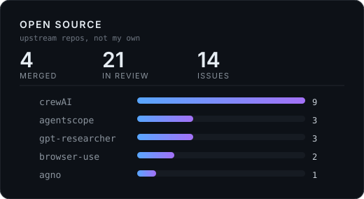

# Hey, I'm Akaliup 👋

**AI Agent / LLM Application Developer**

I build agent systems for cross-border commerce - profit intelligence,
multi-store operations, CRM workspaces - and send every bug I hit back
upstream as a pull request.

---

## What I Build

- ⚙️ **Agent Runtime** — bounded tool loops, capability leases, durable workers, and approval before any action
- 📚 **RAG & Evidence** — hybrid retrieval, `no_answer` refusal, chunk citation checks, and reproducible retrieval evals
- 🔗 **LLM Tooling** — native function calling, read-only MCP servers, and deterministic fallback when no API key is present
- 🌏 **Cross-border Commerce** — profit attribution across FX, platform fees, refunds, and settlement

## Featured Projects

| Project | What it is | Stack |
|---|---|---|
| [ProfitOps-AI](https://github.com/Akaliup/ProfitOps-AI) | Profit intelligence agent: computes margin drift from the real ledger, attributes it to accounting items, then proposes approval-gated simulations with a full audit trail | Python · LangGraph · FastAPI · DeepSeek |
| [Liteclaw](https://github.com/Akaliup/Liteclaw) | Multi-store operations platform that organises support, sourcing, and ads into role-scoped agents with auditable capability boundaries | TypeScript · Agent runtime |
| [ai-native-crm](https://github.com/Akaliup/ai-native-crm) | Agent-native CRM workspace where contacts and deals are the state space, and every run exposes tools, approvals, and data changes | TypeScript · MCP · Postgres |

<!-- OPEN_SOURCE_CONTRIBUTIONS:START -->
## Open Source Contributions

> Updated 2026-11-02 · **4** merged · **20** in review · **13** issues filed

### Merged Pull Requests

| Project | Contribution | PR |
|---|---|---|
| [agno-agi/agno](https://github.com/agno-agi/agno) | Correct FlexAI DeepSeek image-input model id in cookbook README | [#11401](https://github.com/agno-agi/agno/pull/11401) |
| [bytedance/deer-flow](https://github.com/bytedance/deer-flow) | Report video generation failures with a nonzero exit status | [#7034](https://github.com/bytedance/deer-flow/pull/7034) |
| [crewAIInc/crewAI](https://github.com/crewAIInc/crewAI) | Keep runtime input prompts on stderr | [#8297](https://github.com/crewAIInc/crewAI/pull/8297) |
| [helsome/folio](https://github.com/helsome/folio) | 校验规则保存的 IPC 输入 | [#276](https://github.com/helsome/folio/pull/276) |

### Pull Requests In Review

| Project | Contribution | PR |
|---|---|---|
| [agentscope-ai/agentscope](https://github.com/agentscope-ai/agentscope) | Validate session ownership before returning run status | [#3187](https://github.com/agentscope-ai/agentscope/pull/3187) |
| [agentscope-ai/agentscope](https://github.com/agentscope-ai/agentscope) | Preserve missing final newlines in file diffs | [#3244](https://github.com/agentscope-ai/agentscope/pull/3244) |
| [agentscope-ai/agentscope](https://github.com/agentscope-ai/agentscope) | Match newline-containing filenames in glob patterns | [#3386](https://github.com/agentscope-ai/agentscope/pull/3386) |
| [assafelovic/gpt-researcher](https://github.com/assafelovic/gpt-researcher) | Image generation config read with wrong (uppercase) attribute names - feature... | [#2246](https://github.com/assafelovic/gpt-researcher/pull/2246) |
| [assafelovic/gpt-researcher](https://github.com/assafelovic/gpt-researcher) | Config-file REASONING_EFFORT silently reset to medium by _set_llm_attributes | [#2247](https://github.com/assafelovic/gpt-researcher/pull/2247) |
| [assafelovic/gpt-researcher](https://github.com/assafelovic/gpt-researcher) | DOC_PATH and REPORT_SOURCE env overrides ignored by doc path setup | [#2248](https://github.com/assafelovic/gpt-researcher/pull/2248) |
| [browser-use/browser-use](https://github.com/browser-use/browser-use) | Fix tab/space mix in langchain example snippet so it parses | [#6259](https://github.com/browser-use/browser-use/pull/6259) |
| [browser-use/browser-use](https://github.com/browser-use/browser-use) | SchemaOptimizer RecursionError on recursive pydantic models | [#6261](https://github.com/browser-use/browser-use/pull/6261) |

…and 12 more open PRs - [see them on GitHub](https://github.com/search?q=is%3Apr+author%3AAkaliup+-user%3AAkaliup+is%3Aopen&type=pullrequests)

Also reported **13** issues upstream (mostly crewAI, agentscope, MetaGPT).

<!-- OPEN_SOURCE_CONTRIBUTIONS:END -->

## Tech Stack

  
  
  
  
   
  
  
  
  

## Contribution Dashboard

  

## Focus Areas

- Agent runtime: tool loops, state, approvals, and failure recovery
- Retrieval quality: citation traceability and refusal when evidence is thin
- Cross-border profit analysis: FX, fees, refunds, and settlement
- Python and TypeScript services that stay debuggable without an LLM

---

This page updates itself daily from public GitHub data.

